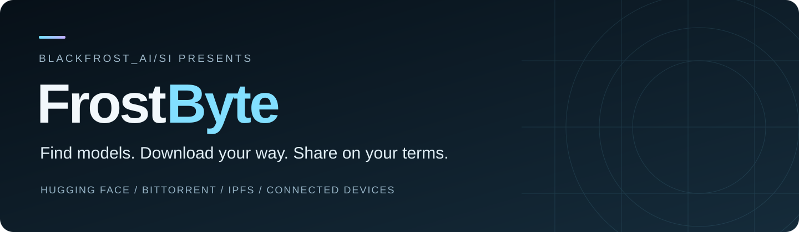
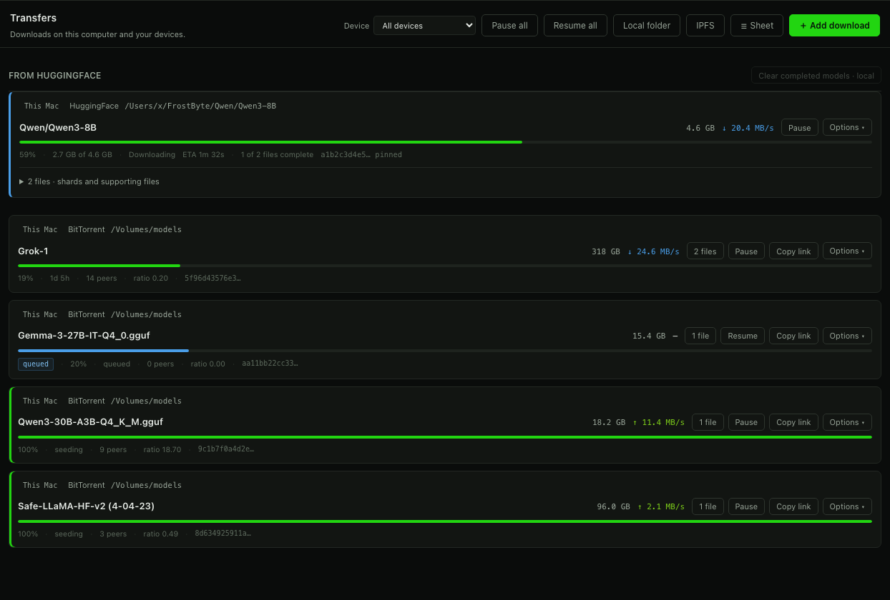
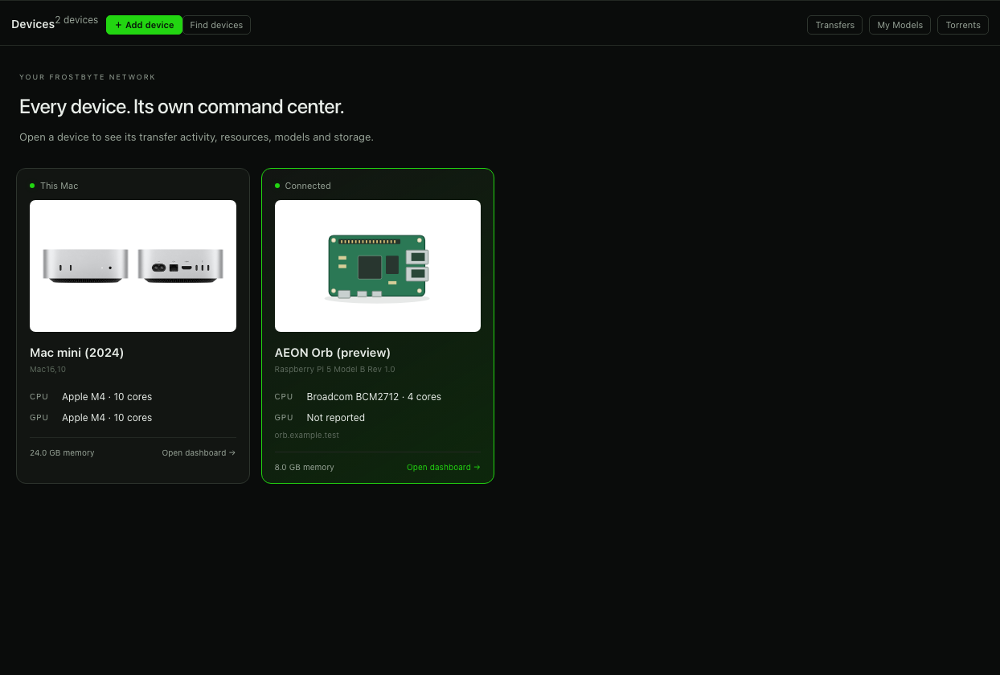

<p align="center"></p>

<p align="center"><strong>A desktop home for your AI model downloads, library and connected devices.</strong><br>Hugging Face, BitTorrent and IPFS — together, with explicit sharing controls.</p>

<p align="center"><a href="https://github.com/Blackfrost-AI/FrostByte-Community/releases">Download</a> · <a href="#your-model-workflow-in-one-place">Explore features</a> · <a href="#get-started">Get started</a> · <a href="CONTRIBUTING.md">Contribute</a></p>

<p align="center">Community 2.0.0 · macOS / Windows / Linux · Apache-2.0<br><strong>Built by Blackfrost_AI/SI</strong></p>

> **Publication status:** this repository and its downloads remain private until the owner authorizes publication. Mac artifacts are Developer ID signed but not notarized; Windows artifacts are not Authenticode-signed. Keep system protections enabled. See [downloads and verification](#download-and-verify).



*Current renderer preview, cropped to the Transfers panel. All model entries, paths, speeds and progress are simulated demonstration data—not a performance benchmark or live download.*

## Your model workflow, in one place

Finding a model is only the beginning. FrostByte brings the download, local library,
transfer controls and connected-device view into one desktop workspace.

| Find and download | Organize and share | Connect and chat |
|---|---|---|
| Browse Hugging Face and download repository files with revision tracking. | Keep downloaded models visible in your local library. | View supported connected devices and their transfer activity. |
| Open torrents, magnets and IPFS CIDs through the appropriate download engine. | Pause, resume, set limits and manage transfer history separately from files. | Use per-device dashboards for models, resources and storage. |
| Search recorded inventory and transfers across your devices. | Choose what to seed or publish; sharing is an explicit action. | Open **Assistant — Beta** for chat with supported running model services. |

### Download through the right source

- **Hugging Face:** repository browsing, resumable downloads, optional authentication for gated/private content, and revision pinning. A Hugging Face download is not automatically a torrent.
- **BitTorrent:** magnet and `.torrent` support, file selection, bandwidth controls and seeding. Use only content you have permission to download and redistribute.
- **IPFS:** CID downloads through the bundled Kubo runtime. Enabling IPFS starts a real network participant; review its settings before use.
- **Model Share:** integrated AEON mirror workflows alongside the other download paths. Availability depends on the source and connected services.

The top search bar searches your inventory and transfers. **It is not a public torrent search engine.**

### Your devices, without losing the details



*Current renderer preview with synthetic devices. No actual LAN scan, device connection or hardware measurement was used for this image.*

See a device's activity, model inventory and storage in its own dashboard.
Approved discovery and configured connections keep credentials and destination
choices explicit. Connected-device views do **not** imply automatic file synchronization.
See the [device guide](docs/DEVICES.md) for setup and supported connections.

### A local assistant, with room to grow

**Assistant — Beta** is a general-chat sidebar for supported model services running
on this computer or configured devices. Discovery can surface supported running
services without manually typing a local endpoint.

It does not load every downloaded model into memory, guarantee support for every
inference server, or provide antivirus scanning. Deeper download-management and
hardware-aware assistance are future work—not promises about today's chat.

## Get started

1. **Install FrostByte** for your platform from [GitHub Releases](https://github.com/Blackfrost-AI/FrostByte-Community/releases). Review the verification and signing notes below.
2. **Choose a source.** Browse Hugging Face, open a torrent or magnet, or add an IPFS CID. Choose the destination and files you want.
3. **Manage your library.** Monitor transfers, pause or resume them, and opt into sharing supported content when you have redistribution rights.

Want to use another machine? Start with the [device guide](docs/DEVICES.md).
Want every control explained? Read the [feature reference](docs/FEATURES.md).

## Built around explicit controls

- **Sharing is a choice.** Download history, file deletion and seeding are separate operations.
- **No app analytics or automatic diagnostic uploads.** Optional feedback opens GitHub without attaching your logs. Network downloads and configured services still communicate with their respective peers/providers.
- **Integrity is not the same as safety.** Hash checks detect byte mismatches; signatures require a trusted identity. File screening and provenance checks are not antivirus, and cannot guarantee a model is harmless.
- **Accounts are optional for local workflows.** Community sign-in supports account-related features; it is not required just to open a torrent.
- **Licenses travel with the content.** FrostByte's Apache-2.0 license does not relicense downloaded models or grant redistribution rights.

Read [Security](SECURITY.md), [privacy and feedback](docs/PRIVACY-AND-FEEDBACK.md),
and the [feature reference](docs/FEATURES.md) before relying on trust indicators.

## Available now. Clearly marked next.

| Available in Community 2.0.0 | Coming next / not shipped |
|---|---|
| Search, download engines, local library and transfer controls | A populated FrostNet community home and activity feed |
| Connected-device dashboards and account-related workflows | Community discovery integrated with what people share |
| General chat through **Assistant — Beta** | Deeper assistant actions and hardware-aware guidance |

**Not provided:** antivirus scanning or any guarantee of safe model execution.

**FrostNet currently displays an inactive Coming Soon placeholder.**
Follow the [community discovery roadmap](docs/COMMUNITY-DISCOVERY.md) and
[release notes](docs/RELEASE-NOTES.md) for the distinction between plans and releases.

## Download and verify

[**Get Community 2.0.0 →**](https://github.com/Blackfrost-AI/FrostByte-Community/releases/tag/v2.0.0)

| Platform | Release formats | Signing status |
|---|---|---|
| macOS · Apple silicon | DMG / ZIP | Developer ID signed; **not notarized** |
| Windows · x64 | EXE / ZIP | **Not Authenticode-signed** |
| Linux · x64 | AppImage / deb | Verify signed checksums |

Each release includes a SHA-256 list, its OpenPGP signature and the release public
key. Follow [verification guidance](SECURITY.md) and independently check the key
fingerprint. A signed checksum is **not OS approval**. If installation is blocked,
keep protections enabled and contact **support@blackfrostai.com**.

Linux qualification uses x64 userspace in Docker on an arm64 host; it does not
establish support for every native kernel or distribution. Release artifacts are
immutable. Current `main` includes a November 23 legal revision that is **not yet
embedded in the original v2.0.0 installers**.

## Build it. Improve it. Make it yours.

Use Node.js **22.12 or newer** on the target operating system:

```sh
npm ci
npm run build:ipfs  # download the checksum-verified Kubo runtime
npm start
```

```sh
npm test
npm run test:engine # real peer-to-peer transfer and hash verification
```

See [Development](docs/DEVELOPMENT.md) for prerequisites and packaging,
[Contributing](CONTRIBUTING.md) for the DCO workflow, and
[Code of Conduct](CODE_OF_CONDUCT.md) for community expectations.

Useful contributions include reproducible bug reports, accessibility improvements,
platform testing and clearer documentation. Report vulnerabilities through
[Security](SECURITY.md), not public issues. If FrostByte is useful to you, a star
helps other people find it—real community support, not a prerequisite to participate.

## License and credits

Built and maintained by **Blackfrost_AI/SI**, with community contributions including
the AEON Model Share integration.

Community code and its bundled companion are [Apache-2.0](LICENSE).
[NOTICE](NOTICE), [third-party notices](THIRD_PARTY_NOTICES.md), and bundled component
and font licenses remain applicable. Historical Founders software, artifacts and
private documentation retain their original terms; they are not Community downloads.

The repository stays private until explicitly opened. The npm package is marked
private to prevent accidental publication; a binary release does not change source
repository visibility.
