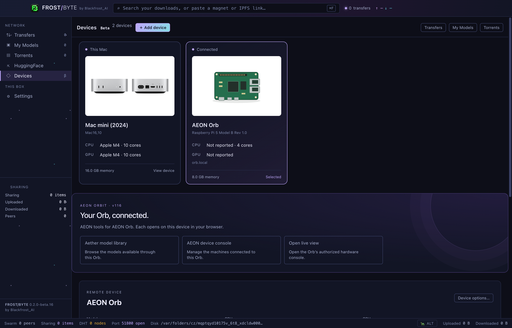

# IPFS and AEON in FrostByte

Desktop beta `0.2.0-beta.16`; downloads use the site's existing invite gate.

FrostByte keeps its existing navigation and download workflow. IPFS is another
source in Transfers. AEON Orbit is an optional appearance setting for everyone.
The Pi tools appear only under the selected connected device reporting the
compatible AEON image capability.

Actual app screenshot from an isolated UI fixture. The example Pi report is
for interface verification; it does not show a connected physical Pi.

## Download from IPFS

1. In Transfers, choose **IPFS**, paste a CID into the top bar, or drop an
   `ipfs://` link. Installed builds also register the IPFS URL scheme.
2. Choose this computer or a connected companion with IPFS support. Choose
   one available folder on that device; external drives are supported for
   the final files. Older companions need the normal **Update companion** flow.
3. Preview the source. A native review identifies the source and destination
   device before it contacts IPFS. Select the files, name the collection and
   choose My Models or Torrents. Review the final download confirmation.
4. One grouped transfer shows progress and pause/resume/cancel controls.
   Completed files appear as one collection in inventory. Clearing transfer
   history keeps those files and their inventory card.
5. Turn **Sharing** on for that collection to publish the selected completed
   files. **Copy IPFS link** copies its published collection CID. Turn Sharing
   off to stop FrostByte serving that collection.

The source CID and newly shared collection CID can differ: only the selected
files are imported into the sharing collection. Names do not establish model
identity. FrostByte accepts immutable SHA-256 UnixFS/raw CIDs; IPNS, arbitrary
gateway URLs, empty directories and executable symlinks are not supported.
Model execution is never part of downloading or enabling sharing.

Equivalent CIDv0/v1 sources normalize to the same identity. The same source
at the same destination is rejected as a duplicate. Files are checked against
the verified IPFS content, written as owned partial files and published without
replacing existing files. Pause/restart verifies partial checksums; an
interrupted final publication can recover its exact owned file.

## AEON origin statements

A model shared from an AEON Orb carries a `model-card.json` listing every file
by path, size and SHA-256. The publisher can sign that list (`aeon-origin/1`).
When a download finishes over IPFS or BitTorrent and its folder holds such a
card, FrostByte compares the card with the files it downloaded and shows the
result on the library card:

- **Origin verified** with the publisher's key. The name beside it is text the
  publisher chose; only the key identifies anyone.
- **Origin unsigned** when the card has no signature. The files are still held
  to the card's list.
- **Origin check failed** with the file that is missing, extra or different, or
  a signature that does not cover these files.

A copy that fails cannot be shared from that item over either protocol, and a
torrent that fails after completing stops seeding. A partial selection that
keeps the publisher's card fails because it is no longer the signed model;
leave the card out to keep an ordinary collection. Only the files FrostByte
recorded for the download are read. The check contacts no network, publishes
nothing and never turns sharing on. It is not a format gate or malware scan.
Torrents that finished before this version are checked when their sharing is
next turned on. BitTorrent copies on a connected companion are not checked yet;
IPFS collections on an updated companion are.

Sharing imports files with fixed parameters: CIDv1, raw leaves, 1 MiB chunks
and SHA2-256. A complete collection that its source imported the same way is
shared under the same CID as the source, so both serve one swarm. Collections
shared by earlier versions get a new CID the next time sharing is turned on. A
release manifest prepared while exactly the same files are shared over IPFS
records that CID beside its torrent identity.

## Storage, privacy and sharing

The receive cache never serves blocks. A separate publisher holds only
explicitly shared collections. Removing a share takes that publisher offline,
removes unwanted pins and cached blocks, then restarts it for the remaining
shares. Stopping the last share stops the publisher. Sharing starts off after
an application/companion restart and must be enabled again explicitly.

The current implementation uses the app/companion state drive for its IPFS
caches. Allow roughly an extra copy for receiving and another when sharing;
final files may be on a different drive. **Settings → Interface → IPFS
storage → Clear local receive cache** removes unneeded receive blocks while
preserving completed files and shared collections. Pause downloads first.
Cache relocation and remote cache controls are follow-up work before large
models are qualified on an SD-card Pi image.

IPFS's rates are independent of the existing torrent caps and schedule. The
sharing card labels publisher-wide upload rates and peer counts as IPFS node
statistics. It does not claim per-file attribution. IPFS is a public peer
network: requests and network addresses can be visible to peers. FrostByte's
optional health diagnostics still exclude download names, paths, CIDs and
history. Updated app terms/privacy require acceptance of their new version.

This adds IPFS as a working transport. It does not combine HF, BitTorrent and
IPFS blocks in one accelerated download or mirror AEON's model catalog. The
existing [HF plus paired-device path](HF-HYBRID.md) continues separately.

## AEON Orbit and Pi devices

Choose **Settings → Interface → Appearance → AEON Orbit** for the purple/cyan
space theme. It changes appearance without requiring a Pi or subscription.

Devices recognizes reported Pi 4/5 hardware and uses a representative original
Pi illustration. Add the Pi through the existing SSH flow and choose its
folder. When a connected Pi running the compatible AEON image reports its
capabilities, its detail panel offers Aether model library, AEON device console
and live view. Each action receives a native review and opens a fixed route
on that device in the system browser, retaining AEON's authentication.

The image marker is feature detection, not cryptographic attestation or a
subscription check. A theme, hostname or model download grants no device
control. A Mac/DGX or offline Pi does not get these tools. See the [image
contract and remaining build work](AEON-IMAGE.md).

## Runtime and testing

`npm run build:ipfs` stages pinned Kubo 0.43.0 for the current platform;
desktop package scripts and companion installers include it automatically.
The Kubo RPC endpoint uses a random bearer secret, loopback-only binding and
an operation allowlist. No general RPC surface is exposed to the renderer.
FrostByte uses its own private repositories and never adopts `~/.ipfs`.
[Runtime and dependency notices](../licenses/ipfs/README.md) remain bundled.

`npm run test:ipfs` covers real isolated Kubo peers, selected-file download,
explicit sharing and retrieval by a second peer, sharing shutdown, duplicate
CID normalization, restart and publication recovery, and missing-file status.
It also checks the AEON signing vectors in `tests/fixtures/model-share-vectors.json`,
origin verification of a signed model, and that re-sharing it yields the CID an
Orb's fixed-parameter import produced.
The Electron tests in `tests/e2e/aeon-ipfs.spec.js` cover actual IPFS download
and sharing through the UI, dropped-link review, persistent appearance and
device-scoped Pi tools. Hardware cards in those tests are fixtures. Neither
they nor a staged ARM64 runtime certify an AEON image or physical Pi.

The application also distinguishes a uTP bind conflict with live TCP fallback
from a failed torrent engine. The network-status fixture verifies the fallback
listener remains reachable and other failures remain errors.

The development validation record is retained in the private archive
for results and untested hardware/release boundaries.

Before a public installer: finish native Windows and Pi image qualification,
align the website's legal version with the updated in-app notices, and follow
the normal release/signing checks. The existing public installers and website
were not changed by this branch.

Primary protocol references: [Kubo RPC](https://docs.ipfs.tech/reference/kubo/rpc/),
[pinned Kubo configuration](https://github.com/ipfs/kubo/blob/v0.43.0/docs/config.md),
and [AEON source reviewed for the device routes](https://github.com/AEON-7/aeon-magick-ai-computer-control/tree/ffb7489e108e82bbbeb3d6248a665960264ec064).
